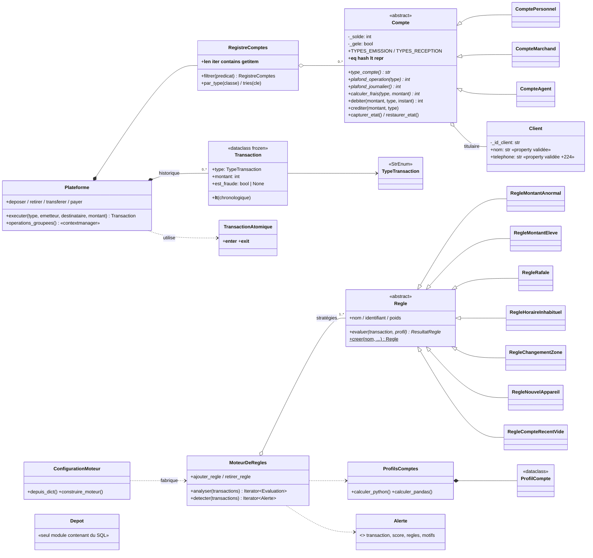

# PayGuard — Rapport de projet

*Programmation Python et introduction à la science des données — Master 1 IASD*

*Auteur : **Salif Soumah** — projet réalisé individuellement (le sujet prévoit un binôme)*

> **Note à l'auteur.** Ce document rassemble les éléments du rapport (8 à 12 pages une fois mis en page).
> Tous les chiffres proviennent d'exécutions réelles : sorties brutes dans `rapport/resultats/`, figures dans
> `rapport/figures/`. Avant la remise, précisez l'usage de ChatGPT (section 9), relisez chaque section,
> **vérifiez que vous savez expliquer chaque choix** et exportez en PDF (par exemple
> `pandoc rapport.md -o rapport.pdf`, ou copie dans un traitement de texte).

---

## 1. Introduction

Un opérateur fictif de paiement mobile en Guinée (dépôts, retraits, transferts entre particuliers, paiements chez
les commerçants) veut une bibliothèque Python interne pour simuler ses comptes, conserver et analyser l'historique,
et signaler les opérations suspectes à l'aide de règles métier, sans apprentissage automatique. PayGuard couvre les
six phases du sujet : génération, modèle objet, Python avancé, persistance et analyse, moteur de règles, qualité
logicielle.

## 2. Architecture et choix de conception

### 2.1 Organisation du paquet

Le paquet suit l'arborescence imposée (`src/payguard/…`). Cinq modules ont été **ajoutés**, aucun n'a été retiré :

| Module ajouté | Raison |
|---|---|
| `schema.py` | Le format de l'annexe A est partagé par la phase 1 (sans classes), le modèle objet et la lecture en flux. Le placer à part évite que le générateur dépende des classes de la phase 2. |
| `journal.py` | Configuration unique de `logging`. Les modules de la bibliothèque n'y posent aucun gestionnaire, c'est la CLI ou le notebook qui le fait. |
| `generation/parametres.py` | Constantes et tirages aléatoires partagés par le générateur et les scénarios ; évite un import circulaire entre ces deux modules. |
| `generation/simulation.py` | Refonte de la phase 2 : le générateur alimente la plateforme. |
| `comptes/registre.py` | La collection de comptes (parcours, filtre, tri) est une responsabilité distincte de la plateforme. |

Le graphe de dépendances est acyclique : `generation(phase 1) → schema` ; `comptes → outils.contextes` ;
`donnees → comptes` ; `detection → donnees, comptes` ; `cli → tout`. pandas et Matplotlib ne sont importés que
par `donnees.analyse`, et à la demande par `donnees.profils` et `donnees.depot`, si bien que `import payguard`
reste léger.

### 2.2 Diagramme de classes

Hiérarchie d'exceptions : `PayGuardError` ← `SoldeInsuffisant`, `PlafondDepasse`, `CompteGele`,
`CompteIntrouvable`, `CompteDejaExistant`, `OperationNonAutorisee`, `ParametreInvalide`, `DonneesInvalides`,
`ConfigurationInvalide`, `DepotError`. Les erreurs de saisie héritent aussi de `ValueError` ou de `LookupError`,
pour rester compatibles avec le code Python idiomatique.

### 2.3 Décisions justifiées

1. **Méthode patron dans `Compte.debiter`.** Les contrôles s'exécutent toujours dans le même ordre : gel, type
   autorisé, plafond par opération, plafond journalier, solde frais compris. Les classes filles ne redéfinissent que
   ce qui varie (plafonds, frais, types), par des méthodes abstraites. On évite ainsi de dupliquer la séquence de
   contrôle et d'oublier un contrôle dans une sous-classe.
2. **Solde encapsulé.** Le solde n'a qu'un accesseur en lecture. Seules `debiter` et `crediter` le modifient, après
   validation.
3. **Égalité par identifiant, ordre par identifiant.** Deux objets qui décrivent le même compte sont égaux, et
   `__hash__` reste cohérent avec `__eq__`. L'ordre naturel par identifiant rend `sorted()` déterministe ; pour
   trier par solde, on passe une clé explicite (`registre.tries(lambda c: c.solde)`), ce qui évite un ordre
   « naturel » ambigu.
4. **Atomicité par mémento.** Plutôt qu'écrire une compensation (« re-créditer si le crédit échoue ») pour chaque
   opération, on capture l'état de chaque participant (solde, cumul journalier, gel) et on le restaure en cas
   d'exception. La plateforme n'ajoute la transaction à l'historique et les frais à ses revenus qu'**après** les
   deux jambes. Le même mécanisme, écrit une fois avec une classe et une fois avec `contextlib`, permet
   `operations_groupees()` (plusieurs opérations en tout ou rien).
5. **Convention émetteur / destinataire.** L'émetteur est le compte **débité**. Pour un dépôt, c'est l'agent (son
   fonds de roulement électronique passe au client) ; pour un retrait, c'est le client. Cette convention donne un
   sens uniforme aux profils (habitudes d'émission).
6. **Transaction immuable.** Une transaction enregistrée est un fait : la dataclass figée interdit toute
   modification et rend l'objet hachable. `est_fraude` vaut `None` quand l'étiquette est inconnue.
7. **Plafonds et frais choisis** (fictifs, mais plausibles en GNF) :

| | Particulier | Marchand | Agent |
|---|---|---|---|
| Émet | retrait, transfert, paiement | retrait, transfert | dépôt, transfert |
| Reçoit | dépôt, transfert | paiement, dépôt, transfert | retrait, transfert |
| Plafond par opération | 5 M | 20 M (retrait), 10 M (transfert) | 10 M (dépôt) |
| Plafond journalier | 15 M | 50 M | 500 M |
| Plafond de solde | 50 M | — | — |
| Frais | transfert 1 %, retrait 1,5 % | retrait 1 %, transfert 0,5 % | aucun |

## 3. Génération des données

### 3.1 Méthode

Le générateur de la phase 1 est écrit en fonctions avec `random`, `csv`, `datetime` et `math`. Toute l'aléa
provient d'une instance `random.Random(graine)` passée explicitement : deux exécutions avec la même graine
produisent le même fichier, octet pour octet (test automatisé).

1. **Comptes.** 3 % d'agents, 10 % de marchands, 87 % de particuliers. Chaque zone a au moins un agent et un
   marchand. Chaque compte a une zone principale (pondérée par la population), une zone secondaire, un ou deux
   appareils, une heure d'activité habituelle, une échelle de montants (loi log-normale) et un niveau d'activité
   (loi log-normale de sigma 1, donc très inégal). Un quart des particuliers ouvre son compte pendant la période.
2. **Opérations légitimes.** Le nombre d'opérations d'un compte est proportionnel à son activité et à sa durée
   d'existence. Les montants sont log-normaux selon le type (médianes : dépôt 250 k, retrait 200 k,
   transfert 120 k, paiement 45 k GNF, multipliées par l'échelle du compte). Les transferts vont surtout vers un
   petit réseau de proches de la même zone.
3. **Cohérence des soldes.** Les opérations sont rejouées dans l'ordre chronologique. Une opération légitime non
   couverte est précédée d'un dépôt de réapprovisionnement. 2 % d'entre elles sont volontairement laissées sans
   provision et seront rejetées par la plateforme. Une fraude non couverte est plafonnée au solde disponible.
4. **Fraudes.** Six scénarios (tableau du README). Chacun ne porte qu'**une partie** des signaux, de façon
   probabiliste (par exemple, un vol de compte n'utilise un nouvel appareil que dans 40 % des cas). En parallèle,
   le bruit légitime crée des faux signaux : couche-tard, changements de téléphone, voyages.
5. **Validation des paramètres.** Les paramètres invalides lèvent `ParametreInvalide` : moins de 50 comptes,
   période de moins de 30 jours, taux hors de [0 ; 0,2], graine non entière, etc.

### 3.2 Jeu produit

Avec les paramètres par défaut (graine 42) : **123 142** transactions brutes, dont 1 830 fraudes (1,49 %),
5 000 comptes, du 1ᵉʳ janvier au 30 juin 2026. Après passage par la plateforme (`payguard simuler`) :
**122 927** transactions acceptées, 215 rejets `SoldeInsuffisant`, 1 829 fraudes (1,49 %). Les empreintes SHA-256
des fichiers figurent dans le README.

## 4. Python avancé

- `@chronometre` mesure la durée d'un appel avec `perf_counter`, la journalise et l'expose (`derniere_duree`).
- `@journaliser` trace les appels, les résultats et les exceptions au niveau DEBUG, puis relance l'exception. Le
  formatage n'a lieu que si le niveau DEBUG est actif.
- `@reessayer(n, delai, exceptions, facteur)` est le décorateur paramétré : il réessaie uniquement sur les
  exceptions déclarées transitoires, avec un délai qui peut croître de façon exponentielle. Il est utilisé pour
  ouvrir SQLite (`OperationalError`, base verrouillée).
- `functools.wraps` préserve le nom, la docstring et la signature (vérifié par `inspect.signature` dans les tests).
- `lire_transactions` est un générateur ligne à ligne et `lire_par_blocs` regroupe ce flux en lots. La mémoire
  reste bornée quelle que soit la taille du fichier. `FenetreGlissanteParCompte` est un itérateur
  (`__iter__` / `__next__`) qui produit des fenêtres partielles au début (sauf avec `completes_seulement`),
  s'arrête proprement en fin de flux et accepte une borne de durée.
- `logging` remplace `print` : un fichier de journal et une console limitée aux avertissements. Seule la CLI
  affiche ses résultats avec `print`.
- `pyproject.toml` rend le paquet installable avec `pip install -e .` et déclare la commande `payguard`.

## 5. Persistance et analyse

### 5.1 Dépôt SQLite

`Depot` est le seul module qui contient du SQL. Il gère le schéma (`CHECK` sur les types et les montants, index
`(id_emetteur, horodatage)`), l'insertion par lots de 5 000 lignes avec `executemany` dans une transaction, et
uniquement des requêtes paramétrées. Un test vérifie qu'une valeur comme `P1' OR '1'='1` est traitée comme une
simple donnée. Les horodatages sont stockés en ISO 8601, si bien que l'ordre du texte coïncide avec l'ordre
chronologique.

### 5.2 Analyse exploratoire (six questions, figures dans `rapport/figures/`)

| Question | Résultat (graine 42) |
|---|---|
| Q1. Montants par type (échelle log) | Distributions log-normales bien séparées : médianes dépôt 347 k, retrait 256 k, transfert 140 k, paiement 46,5 k GNF. |
| Q2. Fraude par heure et par zone | De 7,5 à 11,9 % de fraude entre 0 h et 5 h, contre 1,2 à 1,7 % le reste de la journée. Selon la zone, l'écart est faible (1,26 % à Boké, 1,73 % à Kankan) : la zone seule n'est pas un signal, c'est son **changement** qui compte. |
| Q3. Part du volume du 1 % le plus actif | Les 49 comptes les plus actifs (1 %) portent **19,5 %** du volume émis ; 43 d'entre eux sont des agents. Un seuil de montant unique ne peut donc pas convenir à tous les comptes. |
| Q4. Délai médian avec l'opération précédente | **10,2 h** pour les fraudes contre **3,1 jours** pour les opérations légitimes. Les fraudes suivent de près l'opération précédente (rafales, voyages impossibles, comptes vidés). |
| Q5. Ancienneté et fraude | Hors 30 premiers jours (biais de censure) : 4,8 % de fraude pour les comptes de moins d'un jour, 6,1 % de 1 à 7 jours, contre 1,4 à 1,6 % au-delà de 30 jours. |
| Q6 (libre). Appareil jamais vu | **41,2 %** de fraude depuis un appareil inconnu du compte contre 1,1 % sinon. Ces cas représentent 25 % des fraudes, mais seulement 1 000 transactions. Cela justifie la règle `nouvel_appareil`. |

*Pourquoi la question 6 ?* Le changement d'appareil est le signe le plus direct d'une prise de contrôle de compte
(vol de téléphone, échange de carte SIM, identifiants hameçonnés). Il fallait mesurer à la fois son pouvoir de
détection et le nombre de clients honnêtes qu'il dérangerait.

### 5.3 Profils de comptes : Python pur et pandas

`ProfilsComptes.calculer_python` utilise des boucles, des dictionnaires et des `Counter` ;
`calculer_pandas` utilise `groupby` et `agg`, puis convertit le résultat en objets `ProfilCompte`. Les deux
résultats sont **égaux** (`==` sur 4 999 profils : effectifs, montants, heures, zones, appareils, dernière zone,
réceptions, première apparition).

| Mesure (122 927 transactions, meilleur de 5, Python 3.12, Apple Silicon) | Temps |
|---|---:|
| Python pur (tri compris) | 0,114 s |
| pandas, agrégation vectorisée seule | 0,061 s |
| pandas, agrégation et conversion en objets | 0,095 s |

*Commentaire.* L'agrégation pandas est environ 1,9 fois plus rapide. Une fois la conversion en objets Python
comptée, l'écart tombe à environ 1,2 fois : à ce volume, le coût dominant est la création des 5 000 objets et des
`Counter`, pas le calcul. Avec 100 000 transactions, la version Python reste très rapide (environ 0,1 s), car elle
ne fait qu'une passe O(n) après un tri. pandas prendrait l'avantage sur des volumes beaucoup plus grands, ou si
l'on restait en DataFrame sans revenir à des objets. Ces durées varient d'une machine à l'autre : il faut
relancer `payguard analyser --benchmark` sur la machine de soutenance.

## 6. Moteur de règles

### 6.1 Conception

- `Regle` (abstraite) impose `evaluer(transaction, profil) -> ResultatRegle(regle, declenchee, poids, motif)`.
  Chaque règle valide ses seuils dans son constructeur.
- **Patron Stratégie.** `MoteurDeRegles` ne connaît que l'interface `Regle` : ajouter ou retirer une règle se
  fait par `ajouter_regle` / `retirer_regle` ou par le JSON, sans modifier le moteur. Les sous-classes
  s'enregistrent automatiquement dans un registre (`__init_subclass__`), et la fabrique `Regle.creer(nom, …)`
  valide les noms de paramètres avec `inspect.signature`. Un test écrit une nouvelle règle « liste noire » et la
  branche sans toucher au moteur.
- **Identifiants.** Une même stratégie peut être instanciée plusieurs fois sous des identifiants distincts. C'est
  ainsi qu'on obtient deux paliers de montant tout en gardant un score purement additif.
- **Profils causaux, pas de fuite de données.** `analyser()` parcourt le flux dans l'ordre chronologique, évalue
  chaque transaction avec le profil **antérieur** de son émetteur, puis met ce profil à jour. Le moteur ne lit
  jamais `est_fraude`. Un test inverse toutes les étiquettes et vérifie que les alertes sont identiques. Le même
  code traite un fichier inconnu, sans étiquette, et fonctionne en flux (`detecter --flux`).
- **Alerte.** Dataclass figée (transaction, score égal à la somme des poids, règles, motifs lisibles), triable par
  score. La commande `detecter` affiche, pour **chaque** transaction signalée, les règles déclenchées (`--details`
  ajoute les motifs) et écrit toutes les alertes dans un CSV.
- **Configuration JSON** validée strictement : clés inconnues, types, bornes, règle ou paramètre inconnu, doublons,
  aucune règle active. 17 cas d'erreur sont testés.

### 6.2 Évaluation et coût métier

Le module `evaluation` est écrit à la main : matrice de confusion, taux de détection, précision, taux de fausses
alertes, exactitude, F1, et coût (montant des fraudes manquées + 500 GNF par fausse alerte).

**Pourquoi l'exactitude n'est pas recevable.** Avec 1,49 % de fraudes, un moteur qui ne signale **rien** obtient
98,51 % d'exactitude et laisse passer 100 % des fraudes, soit 949 millions de GNF. Dans le tableau ci-dessous, le
réglage *prudent* a une meilleure exactitude (98,35 %) que le réglage retenu (68,09 %), alors qu'il coûte 21 fois
plus. L'exactitude est dominée par la classe majoritaire et ne pèse pas les erreurs selon leur gravité.

### 6.3 Choix du réglage

**Démarche.** (1) Chaque règle a d'abord été mesurée seule. (2) Une recherche sur grille (poids 1 ou 2 pour six
règles, paliers de montant) a été faite sur le jeu de la graine 42. (3) Le meilleur réglage a été **validé sur la
graine 2026**, jamais utilisée pour le réglage.

| Réglage | Alertes | Détectées | Manquées | Fausses alertes | Détection | Précision | Exactitude | Coût (GNF) |
|---|---:|---:|---:|---:|---:|---:|---:|---:|
| Aucune alerte | 0 | 0 | 1 829 | 0 | 0 % | — | 98,51 % | 949 141 500 |
| Tout signaler | 122 927 | 1 829 | 0 | 121 098 | 100 % | 1,49 % | 1,49 % | 60 549 000 |
| **Retenu, seuil 2** | 40 879 | 1 743 | 86 | 39 136 | 95,30 % | 4,26 % | 68,09 % | **27 281 500** |
| Retenu, seuil 1 | 69 839 | 1 818 | 11 | 68 021 | 99,40 % | 2,60 % | 44,66 % | 34 344 500 |
| Retenu, seuil 3 | 6 598 | 1 153 | 676 | 5 445 | 63,04 % | 17,47 % | 95,02 % | 358 999 000 |
| Retenu, seuil 4 | 1 139 | 685 | 1 144 | 454 | 37,45 % | 60,14 % | 98,70 % | 600 215 500 |
| Équilibré | 9 595 | 1 266 | 563 | 8 329 | 69,22 % | 13,19 % | 92,77 % | 215 359 500 |
| Prudent | 1 945 | 872 | 957 | 1 073 | 47,68 % | 44,83 % | 98,35 % | 583 988 500 |
| *Validation (graine 2026) : retenu* | 40 290 | 1 750 | 75 | 38 540 | 95,89 % | 4,34 % | 68,46 % | 25 594 500 |

**Justification.** Une fraude manquée coûte en moyenne environ 520 000 GNF, soit autant que 1 000 fausses alertes.
Le coût pousse donc à signaler largement les sorties d'argent importantes. Le réglage retenu :

- signale **seule** toute sortie d'argent ≥ 150 000 GNF (dépôts exclus : un dépôt d'espèces chez un agent ne fait
  pas perdre d'argent à l'opérateur) ;
- exige **un indice** comportemental entre 50 000 et 150 000 GNF ;
- laisse `rafale` et `nouvel_appareil` déclencher seules : ce sont les deux règles les plus précises (environ 50 %
  et 47 % de précision quand elles se déclenchent seules).

Il divise le coût par **35** par rapport à l'absence de détection et par **2,2** par rapport à « tout signaler ».
Ses résultats sur le jeu de validation montrent qu'il ne s'est pas sur-ajusté.

Détection par scénario (réglage retenu) : changement de zone 98,8 %, nouvel appareil 98,4 %, horaire 96,0 %,
compte neuf vidé 94,7 %, montant élevé 94,1 %, rafale 93,9 %. Le premier transfert d'une rafale reste invisible
pour une règle causale : on ne peut pas savoir qu'une rafale commence. Évolution mensuelle : un coût stable,
de 4,0 à 5,1 M GNF par mois, et une précision qui augmente avec l'historique (2,9 % en janvier, 6,1 % en juin).

**Limite assumée du critère.** Ce réglage signale environ un tiers des transactions. Il n'est raisonnable que si le
« traitement » à 500 GNF est automatique, par exemple une confirmation par code envoyée au client. Si les alertes
étaient examinées par des analystes en nombre limité, il faudrait minimiser le coût **sous contrainte de
capacité**, et le réglage *prudent* (1 945 alertes, 45 % de précision) serait plus pertinent.

## 7. Qualité logicielle

- CLI `argparse` : `generer`, `simuler`, `analyser`, `detecter`, `evaluer`, avec aide, valeurs par défaut,
  validation des arguments et codes de sortie (0, 1, 2, 130).
- **163 tests pytest**, tous réussis. Couverture **96 %** au total : paquet `comptes` ≈ 95 %, paquet `detection`
  ≈ 97 %. Les tests portent aussi sur les cas d'erreur : exceptions métier, configurations invalides, fichiers mal
  formés, arguments invalides.
- Les tests ont révélé et fait corriger deux défauts réels : des horodatages de création avec des microsecondes
  (aller-retour CSV et SQLite inexact), et des numéros de ligne erronés en présence de lignes vides dans le CSV.
- Le notebook `notebooks/demo.ipynb` s'exécute de bout en bout (0 erreur) et n'appelle que la bibliothèque.

## 8. Limites et perspectives

- **Circularité des données synthétiques.** Les règles ont été conçues en connaissant les scénarios ; les
  performances sur de vraies fraudes, ou sur le jeu de l'enseignant, seront plus faibles.
- **Seuils absolus en GNF.** Les paliers 50 k / 150 k dépendent de la distribution des montants. Une perspective
  serait de rendre les seuils relatifs au profil, ou à des quantiles du fichier analysé.
- **Ancienneté estimée** par la première apparition dans les données, faute de date d'ouverture dans le format
  d'échange.
- **Démarrage à froid** sur un fichier court : peu d'historique par compte, donc moins de règles comportementales
  déclenchées. L'option `--historique` permet d'initialiser les profils.
- **Coût métier à deux niveaux seulement.** Un modèle plus réaliste distinguerait le coût d'une vérification
  automatique de celui d'une enquête humaine, et intégrerait la capacité de traitement.

## 9. Sources et outils

Conformément au sujet, je déclare les sources et outils utilisés au-delà d'une simple consultation de
documentation.

| Source ou outil | Usage |
|---|---|
| Site officiel de Python ([docs.python.org](https://docs.python.org/fr/3/)) | Documentation de référence : `abc`, `dataclasses`, `enum`, `contextlib`, `functools`, `csv`, `sqlite3`, `logging`, `argparse`. |
| **Claude** (Anthropic), via l'assistant de programmation Claude Code | Assistant de programmation utilisé pour écrire le code du paquet, les tests, la configuration du moteur, le notebook, le README et une première version de ce rapport, à partir du sujet et de mes consignes. Les résultats chiffrés proviennent tous d'exécutions réelles du code (sorties dans `rapport/resultats/`). |
| **ChatGPT** (OpenAI) | [À préciser : pour quelles parties ou questions je l'ai utilisé.] |
| `black`, `pycodestyle` | Outils de développement, non requis à l'exécution : mise en forme du code et vérification de la conformité PEP 8 (lignes de 99 caractères au plus). |

J'ai relu le code produit avec l'aide de ces assistants, je l'ai exécuté et testé. Je m'engage à pouvoir en
expliquer chaque partie lors de la soutenance.
